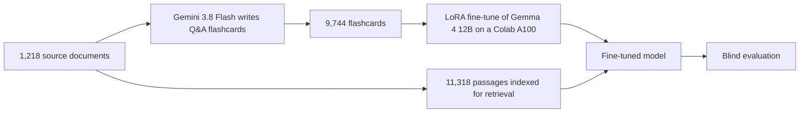

# Brand Manager in a Box: a fine-tuning experiment that failed, measured

I tried to turn a free open model into a better brand-management advisor by feeding it about 1,200 internal brand-management documents from my time at a large consumer-goods company. I built three versions: one fine-tuned on the material, one that looks the material up before answering (retrieval, or RAG), and one that does both. Then I tested every version blind against the plain model.

The plain model won every time.

This repository documents what I built, how I measured it, and why the research literature predicts the result I got. The total cash cost was about $12.

## Results

Each test used 40 brand-strategy questions the models never saw in training. For every question, a judge model read two answers in random order with the labels hidden and picked the one that gave better advice. The judge scored soundness, specificity, insight into the real problem and clarity, and was told to ignore formatting, length and answers cut off by the length limit.

| Comparison | Wins | Ties |
|---|---|---|
| Teacher flashcards vs plain Gemma | 26 to 12 | 2 |
| Fine-tuned Gemma vs plain Gemma | 15 to 25 | 0 |
| Fine-tuned Gemma with retrieval vs plain Gemma | 6 to 34 | 0 |
| Fine-tuned Gemma with retrieval vs plain Gemma with retrieval | 8 to 31 | 1 |
| Plain Gemma with retrieval vs plain Gemma | 11 to 29 | 0 |

In the first row, the flashcards the model trained on beat plain Gemma, so the source material had value. Training did not carry that value into the model.

## What I built

1. **Source selection.** From a 74 GB personal archive I kept only the brand-building, consumer-insight, activation, shopper, measurement and training folders. HR, finance and personal records were excluded. Duplicates, spreadsheet dumps and image-only files were dropped, leaving 1,218 documents.
2. **Synthetic training data.** Gemini 3.8 Flash read each document and wrote 8 question-and-answer pairs: a founder or marketer asks for help, and an experienced brand manager answers by applying the document's thinking to a different category. The prompt banned company names, program names, people and internal figures. I ran it through the Gemini Batch API at half price. It cost about $12 and every document succeeded.
3. **Fine-tuning.** I trained a LoRA adapter (rank 16, about 65 million of Gemma's 12 billion parameters) for one epoch on 9,339 flashcards, holding back two sets of 200 drawn from documents the model never trained on. Training took about an hour on a Google Colab A100 using Unsloth. Training loss fell from 5.06 to 1.88 and validation loss from 1.95 to 1.87.
4. **Retrieval.** I split the same documents into 11,318 passages of about 300 words, embedded them with BGE-base, and gave the model the four closest passages with each question.
5. **Evaluation.** Five blind pairwise comparisons on the same 40 held-out questions, judged by Claude. I chose a judge from a different model family than the teacher, because judges tend to favour answers written in their own style.

## What changed in the fine-tuned model

The model did learn something. Compared with plain Gemma on the 40 test questions:

| Behaviour | Plain Gemma | Fine-tuned |
|---|---|---|
| Answers formatted with slide-style headings | 35 | 2 |
| Answers cut off by the 500-token limit | 29 | 2 |
| Answers that ask the user a pointed question | 27 | 38 |
| Average length in words | 323 | 251 |

It picked up the voice of the flashcards, writing plain prose with the verdict up front. It also picked up a habit of asking a question in almost every answer, which the flashcards did far less often. The judge's notes show what it lost. Its answers more often stated doubtful things with confidence and missed the unstated problem in the question.

## Why it failed

I think three causes combined. Each one matches a published finding.

**The flashcards were written open-book and learned closed-book.** Gemini wrote every answer with the source document in front of it, so the answers contain specifics the student model had no way to know. Training a model to produce facts it doesn't have teaches it to produce confident claims without support. Gekhman et al. found that fine-tuning on new knowledge is learned slowly and that, as the model learns it, its tendency to hallucinate rises ([EMNLP 2024](https://aclanthology.org/2024.emnlp-main.444)). The judge's most common complaint about the fine-tuned answers was confident mistakes.

**Fine-tuning is a weak way to add knowledge.** It mostly changes how a model uses what it already knows. Ovadia et al. compared the two approaches and found retrieval consistently beat fine-tuning for injecting knowledge ([EMNLP 2024](https://aclanthology.org/2024.emnlp-main.15)). My results show the same split: the fine-tune changed the style a lot and the substance for the worse.

**Retrieval pulled in loosely related material.** The source documents cover specific categories and campaigns from about ten years ago. The test questions came from founders selling dog food, socks, seltzer and apps. The search returned passages that shared vocabulary with the question without fitting the situation, and the model used them. The judge repeatedly marked down answers that "borrowed" statistics or cases from unrelated contexts. The fine-tuned model was also never trained with retrieved passages in its prompt, so it had no practice at ignoring irrelevant ones. The RAFT method trains on exactly that, mixing useful passages with distractors ([Zhang et al., 2024](https://arxiv.org/abs/2403.10131)).

Gemma 4 12B already gives good general brand advice, so any change to it had a high chance of doing harm. LoRA limits how far a fine-tune moves the base model ([Biderman et al., 2024](https://arxiv.org/abs/2405.09673)), and in this case it still moved it far enough to hurt.

## What I would do differently

- Measure the plain model before building anything. A day of baseline testing would have shown how high the starting point was.
- Decide what the model should be better at, and test that. My questions were general founder problems, where decade-old category specifics mostly get in the way. The material is more likely to help with questions about applying its methods, such as building an OGSM plan or a consumer proposition, and I never tested those.
- Use retrieval for knowledge and fine-tuning only for voice. For a voice fine-tune, write flashcards whose answers rely on general knowledge the model already has.
- Filter retrieval by relevance and pass fewer passages, or none, when nothing fits.
- If the model is going to see retrieved passages, train it with retrieved passages in the prompt, including irrelevant ones.

## Limitations

- One judge model on 40 questions. The larger gaps (29 to 11, 34 to 6) are well beyond chance for a single judge, though a second judge or human raters would make the results firmer. The 15 to 25 result is suggestive on its own.
- The test questions were written by the same teacher model from held-out documents, so they resemble the training data in style.
- The flashcard answers in the first comparison were written together with their questions by a model reading the source document, which gives them an advantage.
- Plain Gemma's answers were often cut off at 500 tokens. The judge was told to ignore that, and plain Gemma won anyway.
- Answers were sampled at temperature 1.0, so a rerun would produce different text.

## Cost and setup

| Item | Detail | Cost |
|---|---|---|
| Flashcard generation | Gemini 3.8 Flash, Batch API, 1,218 documents | about $12 |
| Training and inference | Google Colab A100, included in a Google AI Pro plan | $0 extra |
| Base model | Gemma 4 12B instruct, Apache 2.0 | free |
| Training library | Unsloth, with transformers 5.10.2 (Gemma 4 12B needs it) | free |
| Retrieval embeddings | BAAI/bge-base-en-v1.5, MIT licence | free |
| Judging | Claude, blind pairwise | included in a Claude plan |

## How to reproduce

The source documents and everything generated from them stay private, so this repository contains code only.

1. `scripts/build_doc_list.py` selects the source documents.
2. `scripts/run_all_parts.sh` sends them to the Gemini Batch API in three parts and merges the results. It stops if the projected cost passes $25, and it can be rerun safely after an interruption. Gemini deletes batch results after 48 hours.
3. `scripts/prepare_dataset.py` cleans the flashcards and splits train, validation and test by source document.
4. `notebooks/train_brand_manager.ipynb` fine-tunes Gemma on Colab. Set `SMOKE_TEST = True` for a ten-minute trial run.
5. `scripts/build_passages.py` and `notebooks/rag_brand_manager.ipynb` build the retrieval index and generate the retrieval answers.
6. The blind pairs, answer keys and verdicts sit in `data/eval/`, which stays private with the rest of `data/` because the answers draw on the source material.
